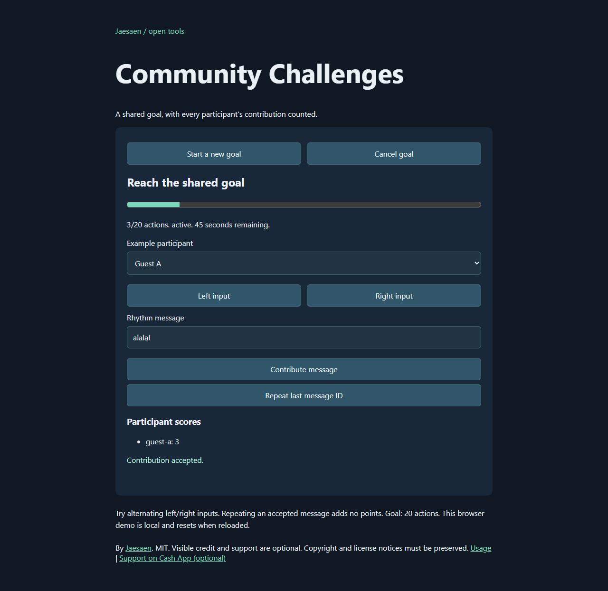

# ChatBound Community Challenges

Deterministic shared goals driven by chat rhythm or alternating pointer inputs. Extracted from Jaesaen's actual Chat-Bound RPG rhythm parser, start-option sanitizer and event behavior. Browser-ready JavaScript and types, no runtime dependencies or game database.


[Try the browser demo](https://jaesonmoment.github.io/chatbound-community-challenges/) | [Download v0.1.0](https://github.com/Jaesonmoment/chatbound-community-challenges/releases/tag/v0.1.0)



## Try it

Serve this folder with a static web server and open `index.html`. The demo keeps state in that browser only. Start a goal, switch between synthetic participants, type `alalal`, alternate left/right inputs, repeat a message, or cancel the goal. Shared progress and participant scores update together. No Twitch login, chat send, saved records, rewards or external services.

One concrete preview path: prerequisite Python 3.8 or newer already installed and available as `python`. Open a terminal in this package's folder and run:

```text
python -m http.server 8000 --bind 127.0.0.1
```

Then open **http://127.0.0.1:8000/** in your browser. Keep that terminal open while previewing; Ctrl+C stops the server. No package install is needed. This is a local preview server, not production hosting. A Node-only alternative is the single-owner example documented below, which prints its available localhost port.

Copy `src/` into your application along with `LICENSE` and `NOTICE.md`:

```js
import {createChallenge, contribute} from './src/index.js';
let state = createChallenge({goalActions:20, durationSec:45}, {
  eventId:'goal-1', scope:'room-1', now:100,
});
const result = contribute(state, {
  eventId:'goal-1', scope:'room-1', participantId:'guest-a',
  messageId:'message-1', now:101, kind:'chat', text:'alalal',
});
state = result.state; // Persist this snapshot before accepting the next input.
```

## Behavior and boundaries

- Immutable snapshots; the same state and input produce the same result. The library never reads a clock or generates IDs. Supply unique event IDs, room/scope IDs, message IDs and nonnegative safe-integer seconds.
- Titles/control characters and start limits are sanitized from the existing implementation. Duration is 15-300 seconds; goals are 10-10,000 actions. Defaults: 45 seconds and 100 actions with neutral labels.
- Chat accepts only a/l rhythm with the original repeated-letter, separator and command-like rejection rules. Chat messages are limited to 280 characters. This is a deliberately specific parser, not arbitrary natural-language matching.
- Direct action contributions must be positive finite numbers. They are floored and bounded to 1-140. Only the remaining goal amount is credited, preventing score overshoot. Every shared action has a matching participant action.
- Pointer inputs count one action. Each participant must alternate left/right; other participants and chat input do not reset that participant's pointer history.
- Accepted message IDs are deduplicated within the specific event/scope. A duplicate cannot add points. Rejected inputs do not consume message IDs. Use unique IDs per message, even across participants. A new event starts fresh deduplication history.
- A matching contribution at or after the expiry boundary expires the event before scoring. Use `tickChallenge` when checking an idle event. Backward or invalid times are ignored/rejected. `cancelChallenge` stops an active event; expired events remain expired.
- Only the input that reaches the goal returns `completedNow:true`. Later contributions are inactive and cannot complete again. Emit notifications from that one result in your owner, after storing state. There are no reward side effects.
- IDs must be nonempty strings without whitespace/control characters, at most 128 characters. State is intended to come from `createChallenge` and these transitions; arbitrary restored state needs validation in your app.

Keep a single authoritative owner per event. Two callers must not independently apply inputs to the same old snapshot. This package provides no hosted/distributed durability, cross-process locking, authentication or durable exactly-once notification delivery. Restarting the local example loses memory.

## Local single-owner example

With Node 22 or newer, run `node examples/local-server.mjs`. It prints a localhost address and serves the browser demo. That demo remains browser-local; the server also provides a separate in-memory example interface:

- `POST /start` with JSON start options creates/replaces a goal in `local-demo` scope.
- `GET /state` checks expiry and returns the current snapshot.
- `POST /contribute` takes the contribution shown above; use the returned server event ID and scope. The server supplies time.
- `POST /cancel` cancels the active goal.

The server binds only to 127.0.0.1 on an available port, checks local Host/same-origin requests, accepts JSON bodies up to 16 KiB, and serves an explicit list of demo files. It is a local demonstration, not a production service. Use synthetic identities. No real user data is needed or retained beyond the current process.

## Checks and license

Run `node --test` or `npm test`, no install step. Tests preserve original parser examples and sanitizer limits and cover aggregate scores, duplicate/scoped IDs, finite input guards, completion, expiry/cancel, alternating pointers, immutable replay and the local owner's interface. Browser acceptance and screenshots are separate QA work.

MIT, copyright [Jaesaen](https://github.com/Jaesonmoment). Preserve the copyright and license notices when redistributing this code. Visible credit and optional sponsorship are appreciated, not required. No royalties. See `NOTICE.md` and `PROVENANCE.md`.

## Optional support

If this tool helps you, you can [support Jaesaen on Cash App](https://cash.app/$jaesaen). Support is voluntary and is not required to use, modify or redistribute the tool under its license. The demo and GitHub funding entry use this same external support link. This project does not collect payment information or process donations.
